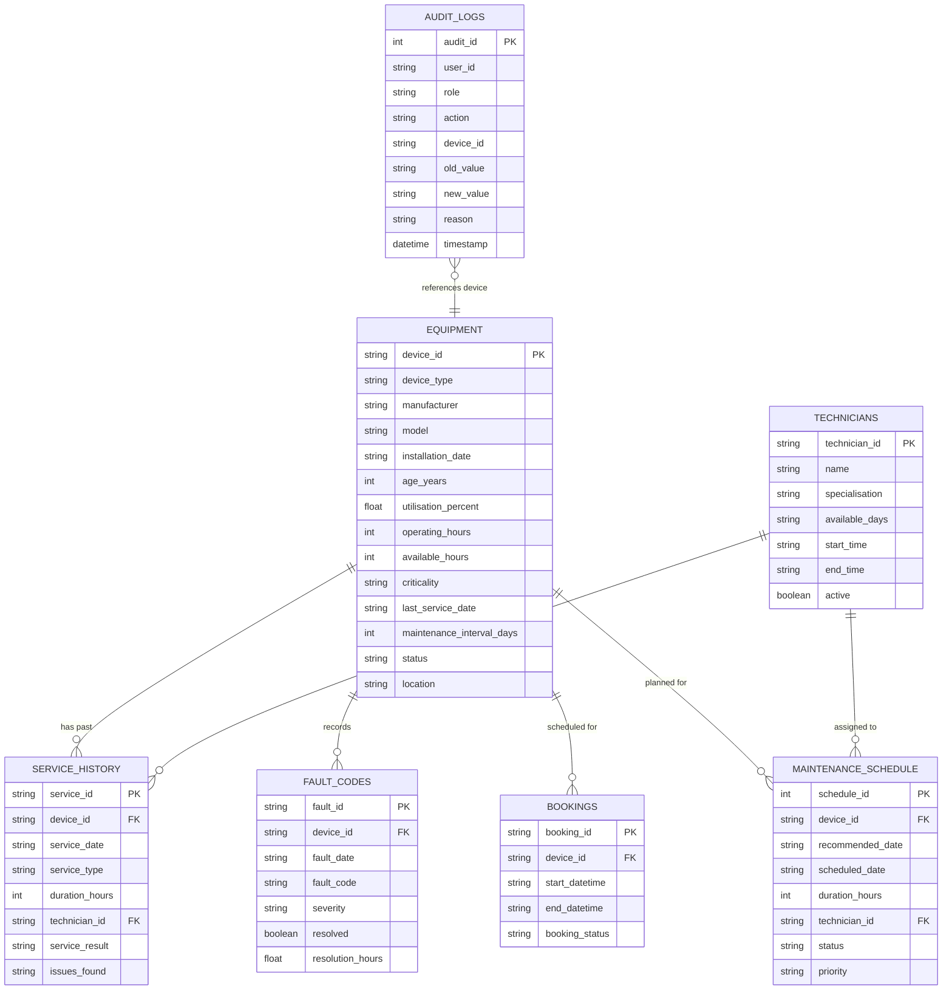

# Usage-Based Preventive Maintenance Planner for Shared High-Value Diagnostic Equipment

**GitHub Repository**: [https://github.com/vishalrajkumar18/CYE-projec](https://github.com/vishalrajkumar18/CYE-projec)

## Project Overview
This project provides an end-to-end working prototype for a diagnostic centre managing shared high-value medical equipment (MRI, CT, etc.). It replaces static, calendar-based maintenance schedules with a usage-based planner to reduce unplanned downtime and optimize operational continuity.

## Problem Statement
A diagnostic centre currently schedules preventive maintenance using fixed calendar intervals. This ignores differences in equipment utilisation, age, fault history, and criticality. The result is unplanned equipment downtime, delayed schedules, and maintenance performed too early on low-risk machines or too late on high-risk machines.

## Objectives
- Build a usage-based preventive-maintenance planner fitting existing workflows.
- Reduce unplanned downtime compared with calendar-only maintenance.
- Enforce Role-Based Access Control, Privacy, and Consent.
- Ensure strict separation of operational support from medical advice.

## Medical Disclaimer
> ⚠️ **IMPORTANT**: This system provides operational maintenance planning support only. It does not provide medical advice, diagnosis, treatment recommendations, or equipment safety certification.

## Features
- Synthetic Data Generation for equipment, service history, faults, and bookings.
- Interpretable Risk-Scoring Engine (Utilisation, Age, Faults, Service, Criticality).
- Feasible Maintenance Planner checking Hard & Soft Constraints.
- Override Workflow for authorized managers with mandatory reason capture.
- Audit Logging (login, consent, approvals, overrides, config changes).
- Traceable, seed-deterministic Evaluation Module with no hard-coded improvement factors.
- Multi-Tier Error Boundaries (defensive data clamping, fail-safe defaults, non-blocking audit).

## Architecture & Technology Stack
- **Frontend**: Streamlit (Python)
- **Backend**: Python (Pandas, Numpy, Scikit-learn, Pytest)
- **Database**: SQLite (`database/maintenance.db`)
- **Visualization**: Plotly Express
- **Documentation**: Markdown, Mermaid Diagrams

---

## Dataset & Documented Seeds

Synthetic datasets are generated by [`generate_data.py`](file:///Users/visahlrajkumar/CYE%20project/maintenance-planner/generate_data.py). Seeds are documented and fixed for full reproducibility:

| Component | Seed | Notes |
|---|---|---|
| `generate_data.py` | `numpy.random.seed(42)` / `random.seed(42)` | Synthetic data generation & edge case injection |
| `src/evaluation.py` | `EVAL_SEED = 42` (`numpy.random.default_rng(42)`) | Traceable simulation & downtime pre-emption |
| `run_evaluation.py` | Uses both seeds above | Automated headless evaluation runner |

> **Fresh Clone Setup**: After cloning, you **MUST** run `python generate_data.py` before starting the app or running the evaluation. The `data/` directory and `database/maintenance.db` are gitignored and not committed to the repository.

---

## Installation & Setup (Fresh Clone)

```bash
# 1. Create and activate virtual environment
python3 -m venv venv
source venv/bin/activate        # Linux / Mac
# venv\Scripts\activate         # Windows

# 2. Install requirements
pip install -r requirements.txt

# 3. Generate synthetic data (REQUIRED — must be run before anything else)
python generate_data.py
# Expected output:
#   Generated equipment.csv
#   Generated service_history.csv
#   Generated fault_codes.csv
#   Generated bookings.csv
#   Generated technicians.csv
#   All synthetic datasets generated successfully.

# 4. Run the Streamlit application
streamlit run app.py

# 5. (Optional) Run the seeded end-to-end evaluation
python run_evaluation.py

# 6. Run all unit and integration tests
PYTHONPATH=. pytest tests/ -v
```

---

## Login Credentials for Demo
*(For demonstration purposes only. Do not use in production.)*

| Username | Password | Role | Permissions |
|---|---|---|---|
| `admin` | `admin123` | Admin | Full access: manage equipment, user provisioning, configure risk weights, override, view logs |
| `manager` | `manager123` | Maintenance Manager | Review recommendations, approve schedules, override with mandatory reason, view logs |
| `technician` | `tech123` | Technician | View assigned tasks, update execution status |
| `operations` | `ops123` | Operations Staff | View equipment availability and schedules (read-only for booking coordination) |

---

## Risk Calculation

The overall risk score is a weighted linear sum:

```
Score = 0.30 × Utilisation + 0.20 × Age + 0.20 × Fault + 0.15 × Service + 0.15 × Criticality
```

### Risk Tiers
- **Low** (0–30): Routine monitoring.
- **Medium** (31–60): Standard maintenance scheduling within 30 days.
- **High** (61–80): Priority maintenance scheduling within 14 days.
- **Critical** (81–100): Urgent maintenance scheduling within 7 days.

**Weight calibration note**: Current weights represent operational assumptions. Future versions should calibrate these against historical service outcome data (e.g., logistic regression on fault-to-failure rates by device type and age cohort).

---

## Planning Logic & Constraints

- **Hard Constraints (Mandatory)**:
  1. *Operational Window*: Scheduled maintenance must fit within facility working hours (08:00 to 18:00).
  2. *Technician Availability*: Assigned technician must be active, working on that weekday, and during shift hours.
  3. *No Patient Booking Conflict*: Interval cannot overlap with existing confirmed patient scans.
- **Soft Constraints (Optimization Preferences)**:
  - Prefers low-utilisation/off-peak periods (before 10:00 or after 15:00).
  - Aligns with certified specialty technicians.
- **Override Workflow**: Maintenance Managers can override a recommended date with a **mandatory written justification reason**, captured in the immutable Audit Log.

---

## Database Schema

The persistence layer is managed via SQLite (`database/maintenance.db`) across seven tables.

### Entity-Relationship Diagram



### Table Specifications

#### 1. `equipment`
Primary asset registry for diagnostic imaging devices.
| Column | Type | Nullable | Default | Description |
|---|---|---|---|---|
| `device_id` | `TEXT` | No | - | **Primary Key**. Unique identifier (e.g., `DEV001`). |
| `device_type` | `TEXT` | No | - | Modality (`MRI`, `CT`, `X-Ray`, `Ultrasound`, etc.). |
| `manufacturer` | `TEXT` | Yes | - | Equipment vendor/OEM (`HealthTech`, `MedSys`, etc.). |
| `model` | `TEXT` | Yes | - | Machine model code. |
| `installation_date` | `TEXT` | Yes | `'2020-01-01'` | Date of commissioning (`YYYY-MM-DD`). |
| `age_years` | `INTEGER` | No | `0` | Operational age in years (clamped $\ge 0$). |
| `utilisation_percent` | `REAL` | No | `0.0` | Operating hours / available hours (clamped $[0, 100]$). |
| `operating_hours` | `INTEGER` | No | `0` | Total hours run in baseline horizon (clamped $\ge 0$). |
| `available_hours` | `INTEGER` | No | `2000` | Standard annual operational capacity (2,000 hrs). |
| `criticality` | `TEXT` | No | `'Medium'` | Clinical impact tier (`Low`, `Medium`, `High`, `Critical`). |
| `last_service_date` | `TEXT` | Yes | `NULL` | Previous service date (`YYYY-MM-DD`). Missing triggers fail-safe max risk. |
| `maintenance_interval_days` | `INTEGER` | No | `180` | Prescribed cycle interval (90, 180, or 365 days). |
| `status` | `TEXT` | No | `'Operational'` | Current state (`Operational`, `Under Maintenance`, `Out of Service`). |
| `location` | `TEXT` | Yes | - | Scan room or hospital department wing. |

#### 2. `service_history`
Chronological logs of historical maintenance events.
| Column | Type | Nullable | Description |
|---|---|---|---|
| `service_id` | `TEXT` | No | **Primary Key** (e.g., `SRV0001`). |
| `device_id` | `TEXT` | No | Foreign Key references `equipment(device_id)`. |
| `service_date` | `TEXT` | No | Date service completed (`YYYY-MM-DD`). |
| `service_type` | `TEXT` | No | `Preventive Maintenance`, `Corrective Maintenance`, `Inspection`, `Calibration`. |
| `duration_hours` | `INTEGER` | No | Duration of service window in hours (1–8). |
| `technician_id` | `TEXT` | No | Foreign Key references `technicians(technician_id)`. |
| `service_result` | `TEXT` | No | Outcome (`Success`, `Follow-up Required`, `Parts Ordered`). |
| `issues_found` | `TEXT` | Yes | Free-text notes or issue summary. |

#### 3. `fault_codes`
Historical and forward-looking error codes used for risk scoring and evaluation pre-emption.
| Column | Type | Nullable | Description |
|---|---|---|---|
| `fault_id` | `TEXT` | No | **Primary Key** (e.g., `FLT0001`). |
| `device_id` | `TEXT` | No | Foreign Key references `equipment(device_id)`. |
| `fault_date` | `TEXT` | No | Timestamp of fault occurrence (`YYYY-MM-DD`). |
| `fault_code` | `TEXT` | No | Diagnostic error code (e.g., `F001 - Temperature Warning`). |
| `severity` | `TEXT` | No | `Low` (10 pts), `Medium` (25 pts), `High` (50 pts), `Critical` (100 pts). |
| `resolved` | `BOOLEAN`| No | Resolution state (`True` / `False`). |
| `resolution_hours` | `REAL` | Yes | Time taken to rectify (imputed via seeded RNG if null). |

#### 4. `bookings`
Patient appointment schedule defining hard constraints against maintenance overlap.
| Column | Type | Nullable | Description |
|---|---|---|---|
| `booking_id` | `TEXT` | No | **Primary Key** (e.g., `BKG0001`). |
| `device_id` | `TEXT` | No | Foreign Key references `equipment(device_id)`. |
| `start_datetime` | `TEXT` | No | Appointment start (`YYYY-MM-DD HH:MM:SS`). |
| `end_datetime` | `TEXT` | No | Appointment end (`YYYY-MM-DD HH:MM:SS`). |
| `booking_status` | `TEXT` | No | `Scheduled`, `Completed`, `Cancelled`. |

#### 5. `technicians`
Service personnel roster, certifications, and availability shifts.
| Column | Type | Nullable | Description |
|---|---|---|---|
| `technician_id` | `TEXT` | No | **Primary Key** (e.g., `T001`). |
| `name` | `TEXT` | No | Technician name. |
| `specialisation` | `TEXT` | No | Modalities certified to maintain (e.g., `MRI, CT`, `All`). |
| `available_days` | `TEXT` | No | Comma-separated list of working weekdays. |
| `start_time` | `TEXT` | No | Daily shift start time (`HH:MM`). |
| `end_time` | `TEXT` | No | Daily shift end time (`HH:MM`). |
| `active` | `BOOLEAN`| No | Active employment flag (inactive technicians cannot be scheduled). |

#### 6. `audit_logs`
Regulatory compliance and accountability audit trail.
| Column | Type | Nullable | Default | Description |
|---|---|---|---|---|
| `audit_id` | `INTEGER` | No | Auto-increment | **Primary Key**. Unique event record. |
| `user_id` | `TEXT` | No | - | Actor identity (`admin`, `manager`, etc.). |
| `role` | `TEXT` | No | - | RBAC role of actor at event execution. |
| `action` | `TEXT` | No | - | Action name (`Login`, `Consent Given`, `Override Schedule`, etc.). |
| `device_id` | `TEXT` | Yes | `NULL` | Targeted device ID if applicable. |
| `old_value` | `TEXT` | Yes | `NULL` | Pre-mutation value. |
| `new_value` | `TEXT` | Yes | `NULL` | Post-mutation value. |
| `reason` | `TEXT` | Yes | `NULL` | Contextual explanation (mandatory for overrides). |
| `timestamp` | `DATETIME`| No | `CURRENT_TIMESTAMP` | Event timestamp. |

#### 7. `maintenance_schedule`
Generated and approved maintenance plans.
| Column | Type | Nullable | Description |
|---|---|---|---|
| `schedule_id` | `INTEGER` | No | **Primary Key** (Auto-increment). |
| `device_id` | `TEXT` | No | Foreign Key references `equipment(device_id)`. |
| `recommended_date` | `TEXT` | Yes | Planner recommended start timestamp. |
| `scheduled_date` | `TEXT` | Yes | Final approved/overridden timestamp. |
| `duration_hours` | `INTEGER` | No | Scheduled slot duration (default 2 hrs). |
| `technician_id` | `TEXT` | Yes | Foreign Key references `technicians(technician_id)`. |
| `status` | `TEXT` | No | `Pending Approval`, `Approved`, `Failed: <reason>`. |
| `priority` | `TEXT` | No | Machine risk priority at generation (`Critical`, `High`, etc.). |

---

## API Endpoints & Programmatic Service Layer

For subsequent technical reviews, the system exposes two complementary interfaces:
1. **Internal Programmatic Service API** (Python modules directly callable in workflows or tests).
2. **RESTful API Specification** (standard microservice contract for enterprise EHR/PACS/CMMS integration).

### 1. Internal Programmatic Service API (Python Modules)

#### `src.data_cleaning`
- **`clean_all_data(equipment_df, fault_df) -> (clean_eq, eq_stats, clean_fault, fault_stats)`**
  - *Description*: Validates, clamps, and deduplicates raw equipment and fault datasets.
  - *Error Boundary*: Clamps utilisation to $\le 100\%$, operating hours to $\ge 0$, negative age to 0, defaults invalid severities to `'Medium'`, and deduplicates on `device_id`.

#### `src.feature_engineering`
- **`engineer_features(equipment_df, fault_df) -> pd.DataFrame`**
  - *Description*: Extracts normalized sub-scores $[0, 100]$ across utilisation, age, criticality, fault severity, and service interval recency.
  - *Fail-Safe Boundary*: If `last_service_date` is missing or unparseable, assigns maximum risk `100.0`.
- **`calculate_utilisation_score(utilisation_percent) -> float`** $[0, 100]$
- **`calculate_age_score(age_years) -> float`** $[0, 100]$
- **`calculate_criticality_score(criticality) -> float`** $(25, 50, 75, 100)$
- **`calculate_fault_score(device_id, fault_df) -> float`** $[0, 100]$
- **`calculate_service_score(last_service_date_str, interval_days) -> float`** $[0, 100]$

#### `src.risk_engine`
- **`calculate_risk_score(features_df, weights=None) -> pd.DataFrame`**
  - *Description*: Computes linear weighted composite score, assigns risk tier (`Low`, `Medium`, `High`, `Critical`), and appends explainability `risk_breakdown`.
  - *Default Weights*: `{'utilisation': 0.30, 'age': 0.20, 'fault': 0.20, 'service': 0.15, 'criticality': 0.15}`.

#### `src.constraints`
- **`check_hard_constraints(start_dt, end_dt, device_id, technician_id, bookings_df, technicians_df) -> (is_valid, constraint_details)`**
  - *Description*: Evaluates operational window (08:00–18:00), active technician shift overlap, and patient scan non-overlap.
- **`check_soft_constraints(start_dt, end_dt, device_id, technician_id) -> details`**
  - *Description*: Evaluates off-peak hours and technician preference heuristics.

#### `src.planner`
- **`recommend_maintenance(device_id, risk_category, duration_hours, bookings_df, technicians_df, base_date_str='2026-09-01') -> (rec_dict, err_msg)`**
  - *Description*: Priority greedy search for earliest conflict-free slot. Returns `(None, err_msg)` if saturated.
- **`generate_schedule(scored_df, bookings_df, technicians_df) -> pd.DataFrame`**
  - *Description*: Prioritizes fleet by risk tier, allocates slots, and handles unfeasible items gracefully.

#### `src.evaluation`
- **`calculate_evaluation_metrics(equipment_df, fault_df, usage_based_schedule, seed=42) -> dict`**
  - *Description*: Traceable, seed-deterministic simulation comparing Calendar-Only vs Usage-Based planning on planning-horizon faults (`>= BASE_DATE`).

#### `src.authentication`
- **`authenticate(username, company_name, phone_number) -> dict`**
  - *Description*: Authenticates user against demo registry or auto-provisions new user.
- **`has_permission(role, action) -> bool`**
  - *Description*: Enforces default-deny RBAC matrix.

#### `src.audit`
- **`log_action(user_id, role, action, device_id=None, old_value=None, new_value=None, reason=None) -> None`**
  - *Description*: Non-blocking audit logger with `try-except` boundary.
- **`get_audit_logs() -> pd.DataFrame`**
  - *Description*: Retrieves full audit trail sorted by timestamp descending.

#### `src.database`
- **`init_db(force=False) -> None`**: Schema creation and initial CSV ingestion.
- **`get_connection() -> sqlite3.Connection`**: Database connection provider.
- **`fetch_table(table_name) -> pd.DataFrame`**: Safe DataFrame extraction.

---

### 2. RESTful API Specification (Headless Microservice Contract)

For production deployment as a FastAPI/Flask microservice, the system defines the following OpenAPI/REST endpoints:

```
Base URL: /api/v1
```

| Method | Endpoint | RBAC Required | Description | Status Codes |
|---|---|---|---|---|
| `POST` | `/auth/login` | Public | Authenticate user credentials & return session profile | `200`, `400`, `401` |
| `GET` | `/equipment` | Any Authenticated | List all diagnostic equipment with filtering (`type`, `risk`, `status`) | `200`, `403` |
| `GET` | `/equipment/{device_id}` | Any Authenticated | Retrieve device details, risk breakdown, fault and service history | `200`, `404` |
| `POST` | `/risk/calculate` | Any Authenticated | Compute risk scores and explainability breakdowns given feature set | `200`, `422` |
| `POST` | `/planner/generate` | Any Authenticated | Run constraint solver to generate risk-prioritized maintenance schedule | `200`, `500` |
| `POST` | `/planner/approve` | `Admin`, `Maintenance Manager` | Approve a recommended maintenance slot | `200`, `403`, `404` |
| `POST` | `/planner/override` | `Admin`, `Maintenance Manager` | Override scheduled date (requires non-empty `reason` payload) | `200`, `400`, `403` |
| `GET` | `/evaluation` | Any Authenticated | Retrieve baseline vs proposed downtime evaluation metrics | `200`, `500` |
| `GET` | `/audit/logs` | `Admin`, `Maintenance Manager` | Query immutable audit log records with date range filtering | `200`, `403` |
| `POST` | `/settings/weights` | `Admin` | Update factor weights (validates that weights sum to $1.0 \pm 0.01$) | `200`, `400`, `403` |

#### Sample Request & Response Payloads

##### `POST /api/v1/planner/override`
- **Request Payload**:
  ```json
  {
    "device_id": "DEV001",
    "new_scheduled_date": "2026-09-08 14:00:00",
    "reason": "Emergency trauma CT scan priority requires shifting PM slot"
  }
  ```
- **Response Payload (200 OK)**:
  ```json
  {
    "status": "success",
    "message": "Maintenance schedule overridden and logged",
    "device_id": "DEV001",
    "previous_date": "2026-09-03 08:00:00",
    "new_scheduled_date": "2026-09-08 14:00:00",
    "audit_id": 42
  }
  ```
- **Error Response (400 Bad Request — Empty Reason)**:
  ```json
  {
    "status": "error",
    "code": "MISSING_JUSTIFICATION",
    "message": "Validation Error: Justification reason is mandatory for override compliance."
  }
  ```

##### `POST /api/v1/settings/weights`
- **Request Payload**:
  ```json
  {
    "utilisation": 0.35,
    "age": 0.15,
    "fault": 0.20,
    "service": 0.15,
    "criticality": 0.15
  }
  ```
- **Response (200 OK)**:
  ```json
  {
    "status": "success",
    "message": "Risk weights successfully updated and logged",
    "total_weight": 1.00
  }
  ```

---

## Evaluation Methodology

The evaluation (`src/evaluation.py` and `run_evaluation.py`) is **traceable and seed-deterministic**.

**Key principles** (no hard-coded improvement factors):

1. **Scope — planning-horizon faults only**: Only faults with `fault_date >= BASE_DATE (2026-09-01)` are evaluated. Historical faults have already occurred regardless of scheduling strategy.

2. **Baseline (Calendar-Only)**: Each device is maintained on its fixed `maintenance_interval_days` cycle from `last_service_date`. Unresolved future faults that occur *before* the calendar maintenance date contribute unplanned downtime.

3. **Usage-Based (Proposed)**: Devices are scheduled by risk score (Critical > High > Medium > Low). Future faults occurring *on or after* the scheduled maintenance date are considered **pre-empted** — they would have been caught at the maintenance window. Constraint-checked scheduling produces zero booking conflicts.

4. **Forward-looking synthetic faults**: `generate_data.py` generates both historical faults (for risk scoring) and predicted future faults (1–90 days after BASE_DATE), calibrated to utilisation, age, and criticality — enabling realistic evaluation of pre-emption benefit.

5. **Reproducibility**: All random choices use `numpy.random.default_rng(seed=42)`; the seed and methodology note are embedded in the evaluation output dict.

---

## Unit Testing & Error Boundaries

For complete technical documentation on the test architecture, mocking patterns, and defensive boundaries, see:
- [docs/testing_and_error_boundaries.md](file:///Users/visahlrajkumar/CYE%20project/maintenance-planner/docs/testing_and_error_boundaries.md)
- [docs/test_cases.md](file:///Users/visahlrajkumar/CYE%20project/maintenance-planner/docs/test_cases.md)

### Test Suite Execution

```bash
PYTHONPATH=. pytest tests/ -v
```

**38 automated tests** across 4 test suites:

| Suite | Tests | Category | Tested Boundary / Objective |
|---|---|---|---|
| [`tests/test_risk_score.py`](file:///Users/visahlrajkumar/CYE%20project/maintenance-planner/tests/test_risk_score.py) | 5 | Unit Tests | Numeric capping $[0, 100]$, fail-safe missing date default (100), weighted linear combination |
| [`tests/test_audit.py`](file:///Users/visahlrajkumar/CYE%20project/maintenance-planner/tests/test_audit.py) | 7 | Unit & Mock | SQLite in-memory isolation (`_no_close`), non-blocking failure boundary, chronological order |
| [`tests/test_evaluation.py`](file:///Users/visahlrajkumar/CYE%20project/maintenance-planner/tests/test_evaluation.py) | 21 | Simulation & Traceability | Pre-emption mechanics, seed determinism (`EVAL_SEED=42`), planning horizon filter, fallback |
| [`tests/test_edge_cases.py`](file:///Users/visahlrajkumar/CYE%20project/maintenance-planner/tests/test_edge_cases.py) | 5 | Integration & System | DEV001 (high usage/no faults), DEV002 (low usage/high faults), DEV003 (no slot), DEV010 (missing data), RBAC |

### Summary of System Error Boundaries

| Layer | Component | Defensive Error Boundary |
|---|---|---|
| **Ingestion** | `src/data_cleaning.py` | Clamps utilisation $>100\%$ to $100\%$; floors negative hours/age to 0; resets invalid criticality/severity to `'Medium'`; deduplicates on `device_id`. |
| **Feature Engineering** | `src/feature_engineering.py` | Fail-safe default: missing service history assigns maximum risk score of 100; traps date parse exceptions; clamps all sub-scores to $[0, 100]$. |
| **Constraint Solver** | `src/planner.py` | Saturated or unfeasible devices return explicit `Failed` status tuple instead of throwing uncaught exceptions; downstream schedule generation continues uninterrupted. |
| **Audit Persistence** | `src/audit.py` | Non-blocking execution: SQL failures are caught in a `try-except` boundary, logging diagnostics to stderr without blocking user actions. |
| **Security & RBAC** | `src/authentication.py`, `app.py` | Default-deny permissions check; lockout to login screen if unauthenticated; lockout to disclaimer screen if consent unacknowledged; mandatory override reason check. |
| **Evaluation Engine** | `src/evaluation.py` | Strict temporal scope filter (`>= BASE_DATE`); deterministic RNG missing value imputation; division-by-zero protection in availability formulas. |

---

## Limitations & Future Improvements

- Synthetic data may not perfectly mirror real hospital behavior.
- Risk weights are operational assumptions requiring calibration against real service outcomes.
- Does not replace manufacturer regulatory maintenance schedules.
- Stakeholder validation is currently simulated; real user trials are required for next phase.
- The `data/` directory and SQLite DB are gitignored; a fresh clone requires `generate_data.py` to be run first (see setup above).
- Future versions could include time-series forecasting, IoT telemetry integration, multi-centre deployment, and a CI/CD pipeline with `run_evaluation.py` as a quality gate.
