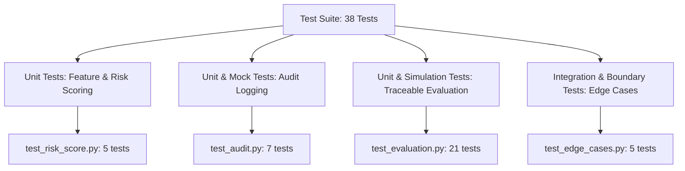
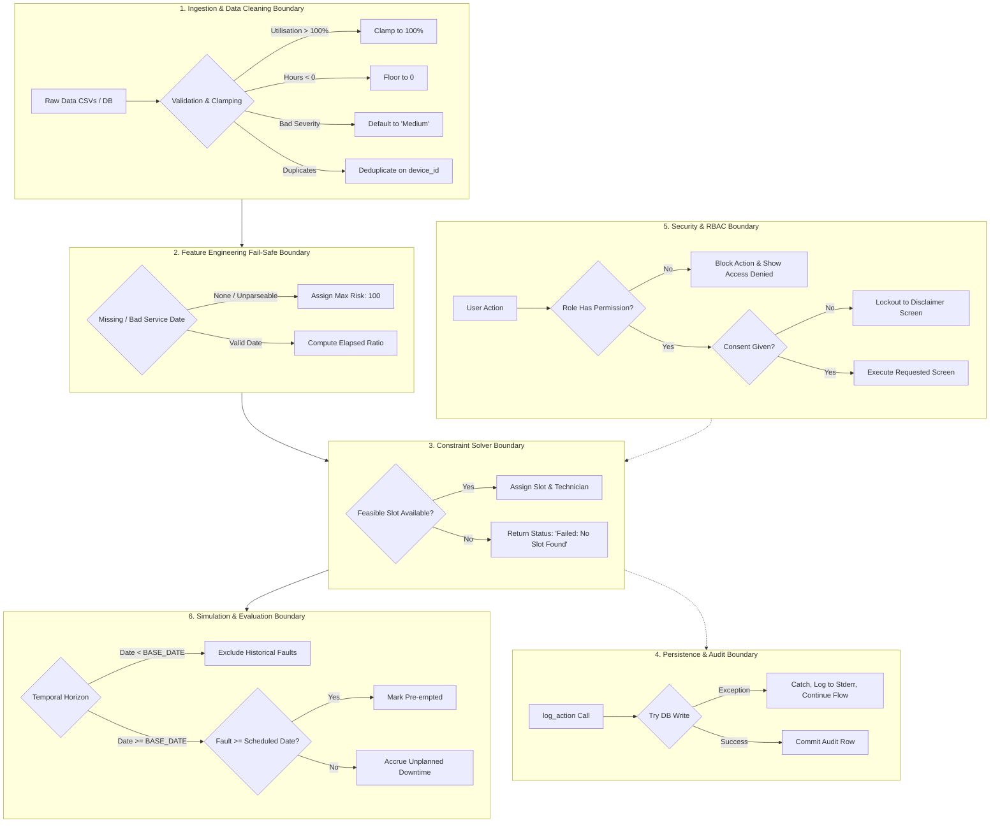

# Granular Technical Documentation: Unit Testing & Error Boundaries

This document provides a comprehensive technical reference for the test suite, mocking architecture, and system-wide error boundaries implemented across the **Usage-Based Preventive Maintenance Planner**.

---

## 1. Testing Framework & Test Taxonomy

The test suite is written using [`pytest`](https://docs.pytest.org/) and structured to validate four distinct architectural tiers:



### 1.1 Running the Test Suite

```bash
# Run all tests with verbose output
PYTHONPATH=. pytest tests/ -v

# Run a specific test suite
PYTHONPATH=. pytest tests/test_risk_score.py -v
PYTHONPATH=. pytest tests/test_edge_cases.py -v
PYTHONPATH=. pytest tests/test_evaluation.py -v
PYTHONPATH=. pytest tests/test_audit.py -v

# Run with test coverage (if pytest-cov installed)
PYTHONPATH=. pytest tests/ -v --cov=src
```

---

## 2. Granular Unit Test Breakdown

### 2.1 Feature Engineering & Risk Scoring (`tests/test_risk_score.py`)

This suite exercises individual mathematical scoring functions and the composite risk score aggregation in [`src/feature_engineering.py`](file:///Users/visahlrajkumar/CYE%20project/maintenance-planner/src/feature_engineering.py) and [`src/risk_engine.py`](file:///Users/visahlrajkumar/CYE%20project/maintenance-planner/src/risk_engine.py).

| Test Name | Tested Function | Inputs / Condition | Expected Output / Assertion | Error Boundary Verified |
|---|---|---|---|---|
| `test_utilisation_score` | `calculate_utilisation_score` | `50`, `150`, `-10` | Exact 50; capped at 100 for 150; floored at 0 for -10 | Bounded numeric range $[0, 100]$ |
| `test_age_score` | `calculate_age_score` | `0`, `15`, `30` | 0 for 0 yrs; 100 for 15 yrs; capped at 100 for 30 yrs | Upper ceiling of 15-year risk horizon |
| `test_criticality_score` | `calculate_criticality_score` | `'Low'`, `'Critical'` | 25 for Low; 100 for Critical | Discrete mapping integrity |
| `test_service_score` | `calculate_service_score` | `None`, `180` days interval | Score 100 (Maximum Risk) | **Fail-safe default for missing data** |
| `test_risk_score_calculation` | `calculate_risk_score` | DataFrame with all sub-scores = 100 | `overall_risk_score == 100.0`, `risk_category == 'Critical'` | Correct weighted linear combination & categorization |

---

### 2.2 Audit Trail & Mocking Architecture (`tests/test_audit.py`)

This suite verifies persistence, field mapping, ordering, and resilience in [`src/audit.py`](file:///Users/visahlrajkumar/CYE%20project/maintenance-planner/src/audit.py) using an **in-memory SQLite database** with custom mocking.

#### The `_no_close` Mocking Pattern
`audit.log_action()` uses a `finally: conn.close()` block. Under standard Python `sqlite3`, calling `.close()` on an in-memory database (`:memory:`) immediately purges its schema and data, making downstream test assertions impossible. 

To overcome this, `tests/test_audit.py` introduces the `_no_close(real_conn)` wrapper:
```python
def _no_close(real_conn):
    mock = MagicMock(spec=real_conn)
    mock.cursor.side_effect = real_conn.cursor
    mock.commit.side_effect = real_conn.commit
    mock.execute.side_effect = real_conn.execute
    mock.close.return_value = None  # Intercept and suppress close
    return mock
```
This isolates the test environment entirely from disk storage without sacrificing realistic SQL execution.

| Test Name | Tested Function | Inputs / Condition | Assertions | Error Boundary Verified |
|---|---|---|---|---|
| `test_log_action_inserts_row` | `log_action` | `user_id='admin'`, `role='Admin'`, `action='LOGIN'` | Exactly 1 row inserted, columns match | SQL parameter substitution |
| `test_log_action_with_all_fields` | `log_action` | Full payload including `device_id`, `old_value`, `new_value`, `reason` | All 8 fields persist accurately | Nullable field handling |
| `test_log_action_multiple_entries` | `log_action` | Sequential calls: LOGIN, APPROVE, CONFIG_CHANGE | 3 rows created with exact action tags | Multi-statement transaction safety |
| `test_log_action_graceful_on_db_error` | `log_action` | `broken_conn` throwing `Exception("DB connection failed")` | Function completes without raising; error logged to stderr/stdout | **Non-blocking audit error boundary** |
| `test_get_audit_logs_returns_dataframe` | `get_audit_logs` | Table populated with sample row | Returns valid `pd.DataFrame` containing `'user_id'` and `'action'` | Query abstraction layer |
| `test_get_audit_logs_ordered_by_timestamp_desc` | `get_audit_logs` | Two rows: T1 ('2026-09-01') and T2 ('2026-09-02') | First row in DataFrame is T2, second is T1 | Timestamp descending sort order |
| `test_log_action_device_id_none_by_default` | `log_action` | Call without `device_id` argument | DB column is `NULL` (None) | Default argument boundary |

---

### 2.3 Evaluation Module & Traceability (`tests/test_evaluation.py`)

This suite validates the simulation engine in [`src/evaluation.py`](file:///Users/visahlrajkumar/CYE%20project/maintenance-planner/src/evaluation.py). It ensures zero hard-coded improvement factors, strict seed determinism, and accurate pre-emption mechanics.

| Test Name | Category | Scope / Tested Behavior | Key Assertions |
|---|---|---|---|
| `test_parse_date_valid` | Date Parsing | Valid `'2026-09-15'` string | Returns `datetime(2026, 9, 15)` |
| `test_parse_date_none` | Date Parsing | `None`, `""`, `float('nan')` | Gracefully returns `None` without exception |
| `test_parse_date_with_time_prefix` | Date Parsing | Timestamp string `'2026-09-15 14:30:00'` | Truncates to date: `datetime(2026, 9, 15)` |
| `test_calendar_maintenance_date_normal` | Baseline | `last_service='2026-03-01'`, `interval=180` | Evaluates to `2026-08-28` |
| `test_calendar_maintenance_date_missing` | Baseline | `last_service=None` | Fallback to `BASE_DATE + 1 day` |
| `test_fault_unplanned_hours_no_faults` | Pre-emption | Empty fault DataFrame | Unplanned downtime $= 0.0$ hrs |
| `test_fault_unplanned_hours_resolved_fault_counts_zero` | Pre-emption | Fault marked `resolved=True` | Unplanned downtime $= 0.0$ hrs |
| `test_fault_unplanned_hours_preempted_fault_counts_zero` | Pre-emption | `fault_date >= maintenance_cutoff` | Fault pre-empted; downtime $= 0.0$ hrs |
| `test_fault_unplanned_hours_historical_fault_excluded` | Temporal Scope | `fault_date < BASE_DATE (2026-09-01)` | Historical faults excluded from future downtime |
| `test_fault_unplanned_hours_before_cutoff_unresolved` | Pre-emption | Future fault before cutoff, `resolved=False` | Accumulates `resolution_hours` |
| `test_fault_unplanned_hours_capped_at_max` | Bounding | `resolution_hours = 48` | Clamped to `UNPLANNED_HOURS_PER_FAULT` (8 hrs) |
| `test_fault_unplanned_hours_imputes_missing_resolution_hours` | Imputation | `resolution_hours = np.nan` | Imputes via seeded RNG in range $[1, 24]$ |
| `test_evaluation_reproducible` | Determinism | Runs `calculate_evaluation_metrics` twice with `seed=42` | Exact equality across all metric values |
| `test_evaluation_seed_in_output` | Metadata | Checks returned dictionary keys | Contains `'seed': 42` and detailed `'methodology_note'` |
| `test_evaluation_no_faults_zero_unplanned` | Sanity | Empty fault dataset | Baseline and proposed unplanned downtime $= 0.0$ |
| `test_evaluation_proposed_less_unplanned_than_baseline` | Efficacy | Multi-device dataset with future faults | `proposed['unplanned_downtime'] <= baseline['unplanned_downtime']` |
| `test_evaluation_failed_schedule_falls_back_to_calendar` | Fallback | Schedule contains `'status': 'Failed'` | Unscheduled devices safely fallback to calendar interval |
| `test_evaluation_reduction_percent_non_negative` | Invariant | Synthetic test scenarios | `reduction_percent >= 0.0` |
| `test_evaluation_planned_downtime_matches_schedule` | Consistency | Compares planned downtime to schedule duration | `proposed['planned_downtime'] == sum(durations)` |
| `test_evaluation_baseline_planned_downtime_is_fixed_calendar` | Baseline | Calculates fixed calendar planned time | Matches $N \times 4$ hours |
| `test_evaluation_low_disruption_higher_unplanned_than_proposed` | Alternative | Compares low-disruption strategy | Yields higher unplanned downtime due to off-peak delays |

---

### 2.4 Integration & Edge Cases (`tests/test_edge_cases.py`)

This suite verifies end-to-end integration across the five critical edge cases defined in hospital requirements:

```
[Edge Case 1: DEV001] -> High Utilisation (95%), Zero Faults -> Risk Engine flags High/Critical solely on usage
[Edge Case 2: DEV002] -> Low Utilisation (20%), 10 Faults   -> Fault weight dominates, pushing to High risk
[Edge Case 3: DEV003] -> 100% Booking Saturation (8-18)     -> Hard constraints fail; planner returns Feasible=False
[Edge Case 4: RBAC]   -> Technician attempts Override       -> Permission denied; override button disabled
[Edge Case 5: DEV010] -> Missing Service History Date       -> Flagged by cleaner; assigned max risk (100)
```

1. **`test_case_1_high_usage_no_faults`**:
   - *Input*: Utilisation 95%, Fault count 0, Operating hours 1900.
   - *Behavior*: Despite zero error logs, high utilisation produces an overall risk score $> 50$, ensuring high-wear devices are scheduled proactively.
2. **`test_case_2_low_usage_high_faults`**:
   - *Input*: Utilisation 20%, 10 high-severity faults.
   - *Behavior*: Fault contribution alone accounts for $\ge 20.0$ points, appropriately penalizing unreliable equipment.
3. **`test_case_3_no_available_slot`**:
   - *Input*: DEV003 fully booked 08:00–18:00 across all technician shifts.
   - *Behavior*: `check_hard_constraints` returns `(False, {'No Booking Conflict': False})`. Planner safely handles unfeasible devices without crashing.
4. **`test_case_4_unauthorised_override`**:
   - *Input*: Role `'Technician'` or `'Operations Staff'` requesting `'override'`.
   - *Behavior*: `has_permission` evaluates to `False`. Only `'Admin'` and `'Maintenance Manager'` evaluate to `True`.
5. **`test_case_5_missing_data`**:
   - *Input*: DEV010 with `last_service_date = None`.
   - *Behavior*: `clean_equipment` increments `missing_service_date_flagged`. `calculate_service_score` assigns safe default `100`.

---

## 3. Comprehensive Error Boundaries Architecture

The application implements **Defense-in-Depth Error Boundaries** across six layers:



### 3.1 Layer 1: Ingestion & Data Cleaning Boundary ([`src/data_cleaning.py`](file:///Users/visahlrajkumar/CYE%20project/maintenance-planner/src/data_cleaning.py))
- **Operating Hours Floor**: Negative operational hours (`operating_hours < 0`) are floored at 0.
- **Utilisation Ceiling**: Utilisation percentages $> 100\%$ are clamped to 100%.
- **Negative Age Floor**: Negative age values (`age_years < 0`) are reset to 0.
- **Categorical Normalization**:
  - Criticality values outside `['Low', 'Medium', 'High', 'Critical']` default to `'Medium'`.
  - Fault severity values outside `['Low', 'Medium', 'High', 'Critical']` default to `'Medium'`.
- **Deduplication**: Equipment records sharing a `device_id` are automatically deduplicated, preserving the first instance.
- **Defensive Auditing**: All cleaning anomalies are tallied and returned in an execution summary dictionary (`eq_stats`, `fault_stats`).

### 3.2 Layer 2: Feature Engineering Fail-Safe Boundary ([`src/feature_engineering.py`](file:///Users/visahlrajkumar/CYE%20project/maintenance-planner/src/feature_engineering.py))
- **Safety-Critical Default Principle**: If equipment service history is missing, corrupted, or unparseable, `calculate_service_score` immediately assigns a score of `100` (highest possible risk). In medical diagnostic environments, absence of maintenance records must never be treated as "healthy."
- **Date Parse Exception Trap**: Parsing of `last_service_date` is wrapped in a strict `try-except` block; any parsing anomaly returns `100`.
- **Normalization Ceilings**: All sub-scores (Utilisation, Age, Faults, Criticality, Service) are capped using `min(..., 100)`.

### 3.3 Layer 3: Constraint Solver Boundary ([`src/constraints.py`](file:///Users/visahlrajkumar/CYE%20project/maintenance-planner/src/constraints.py), [`src/planner.py`](file:///Users/visahlrajkumar/CYE%20project/maintenance-planner/src/planner.py))
- **No Active Technicians**: If all technicians are inactive, `recommend_maintenance` safely returns `(None, "No active technicians")`.
- **Booking Saturation**: If a device cannot be scheduled within its priority search horizon without violating patient bookings or operational hours, the solver returns `(None, "No available maintenance slot found")`.
- **Graceful Schedule Degradation**: Failed recommendations do not abort schedule generation. Instead, unfeasible items are tagged with `'status': 'Failed: <reason>'`, allowing human managers to intervene or fall back to calendar maintenance.

### 3.4 Layer 4: Persistence & Audit Boundary ([`src/audit.py`](file:///Users/visahlrajkumar/CYE%20project/maintenance-planner/src/audit.py), [`src/database.py`](file:///Users/visahlrajkumar/CYE%20project/maintenance-planner/src/database.py))
- **Non-Fatal Audit Failure**: Audit logging is designed as a non-blocking diagnostic facility. If the SQLite database is locked, corrupted, or unreachable, `log_action` catches the exception, prints an error message to stdout/stderr, and allows core operational workflows (user login, schedule approval, override submission) to proceed uninterrupted.
- **Deterministic Resource Deallocation**: Connection closing is wrapped in `finally: conn.close()` to prevent file descriptor leaks or database lock starvation.

### 3.5 Layer 5: Security, Consent, and Access Control Boundary ([`src/authentication.py`](file:///Users/visahlrajkumar/CYE%20project/maintenance-planner/src/authentication.py), [`app.py`](file:///Users/visahlrajkumar/CYE%20project/maintenance-planner/app.py))
- **Authentication Gate**: Any access attempt without an active session is intercepted and redirected to `login_screen`.
- **Medical Disclaimer Consent Gate**: The system enforces operational support separation. Users cannot access any dashboard, equipment, planner, or settings screen until `consent_given` is explicitly acknowledged.
- **RBAC Matrix Boundary**: UI controls and sensitive backend logic are gated by `has_permission(role, action)`:
  - Overriding a schedule requires `'override'` permission (restricted to Admin and Maintenance Manager).
  - Modifying risk weights requires `'config_weights'` permission (restricted to Admin).
  - Viewing the audit trail requires `'view_logs'` permission (restricted to Admin and Maintenance Manager).
- **Mandatory Justification Boundary**: Submitting an override without entering a textual `reason` is rejected with a validation error.
- **Weight Conservation Boundary**: Risk weight reconfiguration requires that weights sum to $1.0 \pm 0.01$.

### 3.6 Layer 6: Simulation & Evaluation Boundary ([`src/evaluation.py`](file:///Users/visahlrajkumar/CYE%20project/maintenance-planner/src/evaluation.py))
- **Temporal Scope Filter**: Historical faults occurring before `BASE_DATE (2026-09-01)` are strictly excluded from downtime calculations, ensuring the evaluation reflects only future pre-emptions.
- **Deterministic Imputation**: If resolution hours are missing in synthetic records, values are imputed using `numpy.random.default_rng(seed)`.
- **Zero-Division Guards**: The `_availability` and `reduction_percent` calculation functions guard against zero devices or zero baseline downtime, preventing `ZeroDivisionError`.
