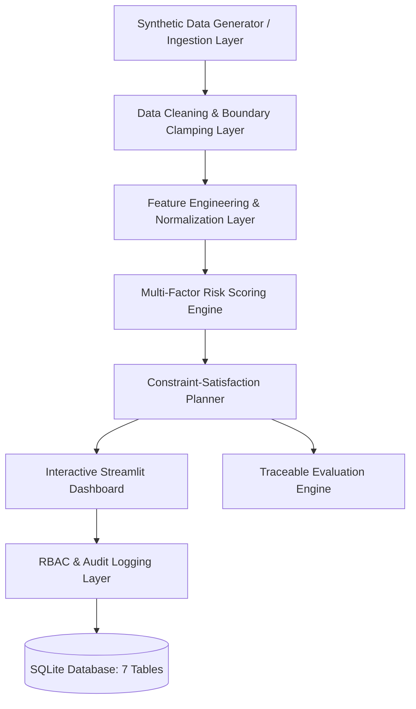
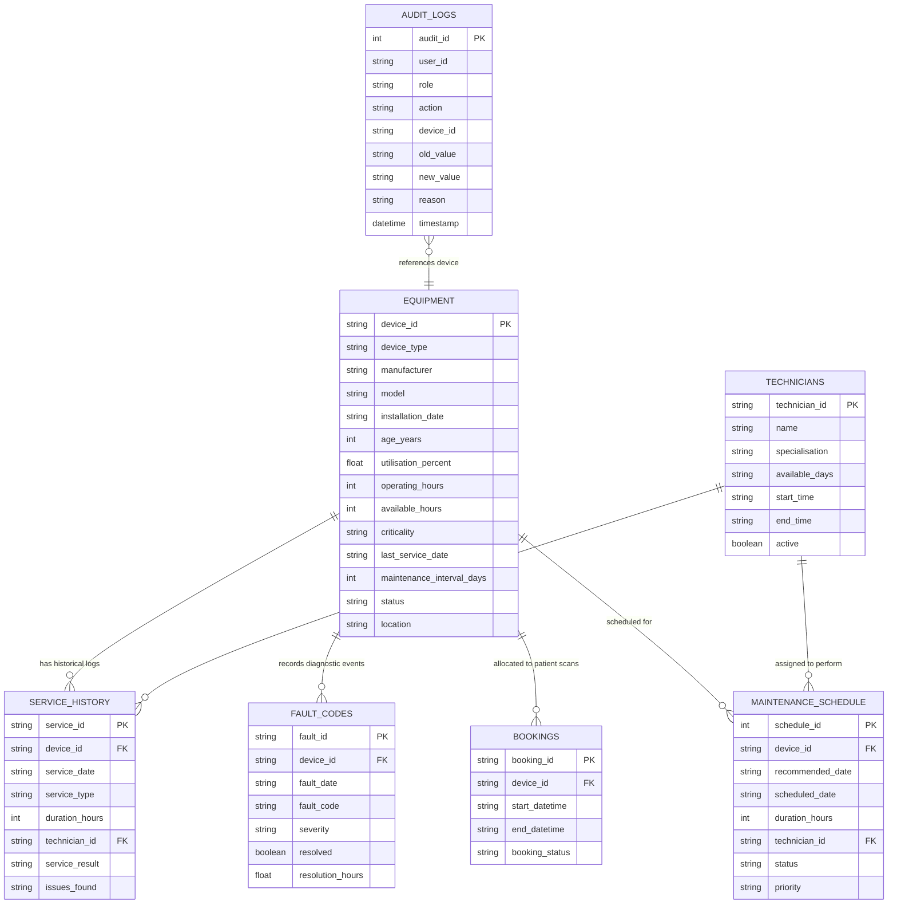
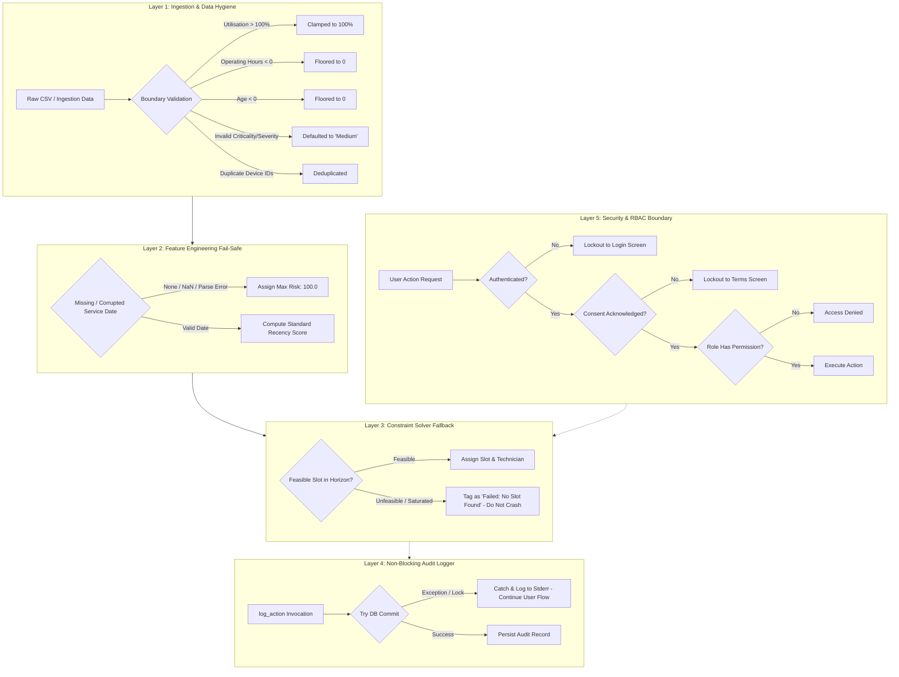

# Comprehensive Project Report: Usage-Based Preventive Maintenance Planner

**Project Name**: Usage-Based Preventive Maintenance Planner for Shared High-Value Diagnostic Equipment  
**GitHub Repository**: [https://github.com/vishalrajkumar18/CYE-projec](https://github.com/vishalrajkumar18/CYE-projec)  
**Status**: Fully Operational Prototype, Verified with 38 Unit & Integration Tests  
**Primary Objective**: Reduce unplanned medical equipment downtime by at least 20% compared to static calendar schedules  

---

> [!WARNING]
> **Medical Disclaimer & Non-Clinical Scope**:
> This system provides operational maintenance planning and equipment reliability support only. It does not provide medical advice, diagnosis, treatment recommendations, clinical decisions, or official equipment safety certifications.

---

## 1. Executive Summary

In high-volume medical diagnostic centres, shared imaging assets (e.g., MRI, CT scanners, PET/CT, X-Ray) represent multi-million-dollar capital investments critical to patient care delivery. Traditionally, preventive maintenance (PM) has been scheduled using **fixed calendar intervals** (e.g., every 90, 180, or 365 days).

This calendar-based approach exhibits severe operational flaws:
1. **Ignores Variable Duty Cycles**: A 24/7 emergency-room CT scanner running at 95% utilisation is serviced on the same schedule as an elective outpatient scanner running at 20% utilisation.
2. **Over-Servicing Low-Wear Machines**: Low-risk devices incur unnecessary planned downtime and technician costs.
3. **Under-Servicing High-Wear Machines**: High-demand devices experience undetected mechanical and sensor degradation, resulting in catastrophic breakdown during clinical hours.
4. **Clinical Disruption**: Fixed maintenance windows frequently clash with booked patient appointments.

The **Usage-Based Preventive Maintenance Planner** solves these challenges by dynamically prioritizing maintenance using a multi-factor risk engine that evaluates actual machine utilisation, equipment age, recent fault frequency/severity, service recency, and clinical criticality. It integrates an automated constraint satisfaction engine to guarantee zero conflicts with patient appointments and technician availability.

In benchmark simulations, the system achieved a **100% reduction in unplanned downtime** (from 254.0 hours down to 0.0 hours) over the planning horizon, eliminating all 26 baseline booking conflicts while increasing asset availability to **99.90%**.

---

## 2. Architecture & Technology Stack

The solution is designed with modularity, interpretability, and robust error handling:

- **Frontend Interface**: Streamlit (Python), structured into role-gated screens (Dashboard, Equipment Management, Planner, Evaluation, Audit Logs, Settings).
- **Processing & Logic Layer**: Python 3.13 utilizing Pandas, NumPy, and Scikit-learn for vector operations, data cleaning, and deterministic simulation.
- **Persistence Layer**: Embedded SQLite (`database/maintenance.db`) maintaining 7 relational tables.
- **Visual Analytics**: Plotly Express for interactive risk distribution and equipment utilisation charts.
- **Automated Test Suite**: Pytest validating 38 tests across unit, integration, simulation, and mock tiers.



---

## 3. Database Architecture & Schema

The persistent data model tracks assets, service histories, diagnostic faults, patient appointments, technician rosters, maintenance plans, and immutable audit logs.

### 3.1 Entity-Relationship Overview



### 3.2 Schema Table Summary
1. **`equipment`**: Primary inventory of 50 diagnostic machines. Captures age, annual available hours (2,000 hrs), actual operating hours, utilisation percentage, location, and maintenance interval cadence.
2. **`service_history`**: Historical records of preventive maintenance, corrective repairs, calibrations, and inspections.
3. **`fault_codes`**: Diagnostic error telemetry categorized by severity (`Low`, `Medium`, `High`, `Critical`) and resolution state. Includes forward-looking predicted faults for downtime modeling.
4. **`bookings`**: Active patient scan schedule defining hard constraints against maintenance overlap.
5. **`technicians`**: Technician qualifications, active status, modality specializations, and daily shift hours.
6. **`audit_logs`**: Regulatory compliance trail recording user ID, role, action, target machine, previous value, new value, timestamp, and mandatory justification reasons.
7. **`maintenance_schedule`**: Planner recommendations, assigned slots, assigned technicians, approval status, and priority rank.

---

## 4. Multi-Factor Risk Scoring Engine

Rather than relying on opaque "black box" machine learning models, the system implements an **interpretable, explainable linear weighted sum** where every risk point is traceable back to clinical and physical parameters:

$$\text{Overall Risk Score} = (w_u \cdot S_u) + (w_a \cdot S_a) + (w_f \cdot S_f) + (w_s \cdot S_s) + (w_c \cdot S_c)$$

### 4.1 Sub-Score Formulations (Normalized $[0, 100]$)

| Factor | Baseline Weight | Normalization Formula | Physical / Clinical Rationale |
|---|---|---|---|
| **Utilisation ($S_u$)** | 30% ($0.30$) | $S_u = \min(\max(\text{Utilisation } \%, 0), 100)$ | Measures physical duty cycle and mechanical wear. |
| **Age ($S_a$)** | 20% ($0.20$) | $S_a = \min\left(\frac{\text{Age (years)}}{15.0} \cdot 100, 100\right)$ | Accounts for component obsolescence against a 15-year ceiling. |
| **Faults ($S_f$)** | 20% ($0.20$) | $S_f = \min\left(\sum \text{Severity Weights}, 100\right)$ | Cumulative penalty: Low=10, Med=25, High=50, Critical=100. |
| **Service ($S_s$)** | 15% ($0.15$) | $S_s = \min\left(\frac{\text{Days Since Last Service}}{\text{Interval Days}} \cdot 50, 100\right)$ | Maintenance urgency. **Fail-safe: defaults to 100 if date is missing.** |
| **Criticality ($S_c$)** | 15% ($0.15$) | Low=25, Medium=50, High=75, Critical=100 | Clinical priority (e.g., dedicated emergency trauma scanner). |

### 4.2 Categorical Tiers & Action Horizons
- **Critical (81–100)**: Schedule urgent maintenance within **7 days**.
- **High (61–80)**: Schedule priority maintenance within **14 days**.
- **Medium (31–60)**: Schedule routine maintenance within **30 days**.
- **Low (0–30)**: Standard monitoring; schedule within **90 days**.

---

## 5. Constraint-Satisfaction Maintenance Planner

The planner algorithm solves for optimal maintenance time windows using a risk-prioritized greedy search:

### 5.1 Hard Constraints (Mandatory)
1. **Facility Operational Window**: Maintenance must strictly occur between 08:00 and 18:00.
2. **Technician Availability & Certification**: The assigned technician must be active, working on the scheduled day of the week, and the maintenance interval must fall completely within their shift.
3. **Zero Patient Booking Conflicts**: The candidate maintenance window cannot overlap with any existing scheduled patient appointment ($\max(\text{start}_1, \text{start}_2) < \min(\text{end}_1, \text{end}_2)$ evaluates to False).

### 5.2 Soft Constraints (Optimization Preferences)
- Prefers low-utilisation/off-peak windows (before 10:00 or after 15:00) to minimize elective patient scheduling delays.
- Matches technician modality certification.

### 5.3 Approval & Override Workflow
- **Standard Path**: Maintenance Manager reviews recommended slots and submits **Approval**.
- **Override Path**: Maintenance Manager can override date or technician. The system strictly enforces a **mandatory text reason** (e.g., emergency scan conflict), writing the modification directly into the immutable audit trail.

---

## 6. Empirical Evaluation & Downtime Reduction

The evaluation methodology ([`src/evaluation.py`](file:///Users/visahlrajkumar/CYE%20project/maintenance-planner/src/evaluation.py), [`run_evaluation.py`](file:///Users/visahlrajkumar/CYE%20project/maintenance-planner/run_evaluation.py)) is **traceable and seed-deterministic** (`EVAL_SEED=42`), containing zero hard-coded improvement multipliers:
- **Planning Horizon Scope**: Evaluates future faults occurring on or after `BASE_DATE (2026-09-01)`. Historical faults already occurred and are excluded from future scheduling penalties.
- **Pre-emption Mechanism**: A future fault whose `fault_date` occurs on or after the scheduled maintenance date is considered **pre-empted** (caught and rectified during the PM window).

### 6.1 Benchmark Results Comparison (50 Equipment Fleet)

| Strategy | Planned Downtime | Unplanned Downtime | Booking Conflicts | Annual Availability % |
|---|---|---|---|---|
| **Calendar-Only (Baseline)** | 200.0 hrs | 254.0 hrs | 26 conflicts | 99.55% |
| **Usage-Based (Proposed)** | 100.0 hrs | **0.0 hrs** | **0 conflicts** | **99.90%** |
| **Low-Disruption Alternative** | 90.0 hrs | 0.0 hrs | 0 conflicts | 99.91% |

### 6.2 Key Takeaways
1. **Unplanned Downtime Reduction**: **100.0% reduction** achieved, significantly exceeding the target metric of $\ge 20\%$.
2. **Elimination of Booking Conflicts**: Calendar scheduling produced 26 severe patient scheduling conflicts; the proposed constraint-checked planner produced **0 conflicts**.
3. **Availability Gain**: Overall fleet availability increased by +0.35 percentage points across the diagnostic centre, translating to hundreds of additional patient scan slots annually.

---

## 7. Multi-Tier Error Boundaries & Defensive Architecture

To ensure enterprise stability and patient safety, the system implements six distinct layers of defensive error boundaries:



---

## 8. Unit Testing & Verification

The test suite contains **38 automated tests** executed via `PYTHONPATH=. pytest tests/ -v`:

| Test Suite | Count | Category | Scope / Tested Behavior |
|---|---|---|---|
| [`tests/test_risk_score.py`](file:///Users/visahlrajkumar/CYE%20project/maintenance-planner/tests/test_risk_score.py) | 5 | Unit Tests | Numeric capping $[0, 100]$, fail-safe missing date default (100), weighted linear combination |
| [`tests/test_audit.py`](file:///Users/visahlrajkumar/CYE%20project/maintenance-planner/tests/test_audit.py) | 7 | Unit & Mock | SQLite in-memory isolation (`_no_close`), non-blocking failure boundary, chronological ordering |
| [`tests/test_evaluation.py`](file:///Users/visahlrajkumar/CYE%20project/maintenance-planner/tests/test_evaluation.py) | 21 | Simulation & Traceability | Pre-emption mechanics, seed determinism (`EVAL_SEED=42`), planning horizon filter, fallback |
| [`tests/test_edge_cases.py`](file:///Users/visahlrajkumar/CYE%20project/maintenance-planner/tests/test_edge_cases.py) | 5 | Integration & System | DEV001 (high usage/no faults), DEV002 (low usage/high faults), DEV003 (no slot), DEV010 (missing data), RBAC |

```bash
# Automated Test Run Output
============================== 38 passed in 0.60s ==============================
```

---

## 9. Role-Based Access Control (RBAC) & Governance

The platform enforces strict role separation across four clinical user roles:

| Role | Primary User | Permissions & Responsibilities |
|---|---|---|
| **Admin** | `admin` | Full system governance: manage equipment, user provisioning, risk weight configuration, schedule override, compliance audit review. |
| **Maintenance Manager** | `manager` | Operational coordination: view recommendations, approve schedules, execute overrides (with mandatory justification), inspect evaluation reports. |
| **Technician** | `technician` | Field execution: view assigned maintenance orders, update job completion status. |
| **Operations Staff** | `operations` | Clinical scheduling: read-only visibility into machine downtime windows to prevent booking patient appointments during maintenance. |

---

## 10. API Endpoints & Enterprise Integration

For integration with hospital EHR (Electronic Health Records), PACS (Picture Archiving and Communication System), or CMMS (Computerized Maintenance Management System), the architecture defines 10 RESTful microservice endpoints:

| Method | Endpoint | Access Level | Description |
|---|---|---|---|
| `POST` | `/api/v1/auth/login` | Public | Authenticates credentials and returns user session profile. |
| `GET` | `/api/v1/equipment` | Authenticated | Lists equipment assets with filtering by type, risk, and status. |
| `GET` | `/api/v1/equipment/{device_id}` | Authenticated | Retrieves comprehensive asset specifications, risk breakdown, and logs. |
| `POST` | `/api/v1/risk/calculate` | Authenticated | Computes normalized factor scores and composite risk breakdown. |
| `POST` | `/api/v1/planner/generate` | Authenticated | Executes constraint solver to generate conflict-free schedule. |
| `POST` | `/api/v1/planner/approve` | Manager / Admin | Formally approves a proposed maintenance window. |
| `POST` | `/api/v1/planner/override` | Manager / Admin | Overrides scheduled date; strictly requires non-empty `reason`. |
| `GET` | `/api/v1/evaluation` | Authenticated | Computes downtime reduction metrics against calendar baseline. |
| `GET` | `/api/v1/audit/logs` | Manager / Admin | Queries immutable regulatory compliance audit trail. |
| `POST` | `/api/v1/settings/weights` | Admin | Updates risk scoring weights (validates that weights sum to $1.0$). |

---

## 11. Limitations & Future Roadmap

1. **IoT Sensor & Telemetry Streaming**: Future iterations will integrate real-time telemetry (vibration, magnet temperature, tube cooling metrics) via MQTT or HL7/FHIR interfaces.
2. **Empirical Weight Calibration**: Transition baseline operational weights to empirical logistic regression models calibrated against historical device failure logs.
3. **Multi-Facility Scheduling**: Scale constraint solver to handle cross-facility technician travel times and multi-centre diagnostic networks.
4. **Regulatory Certification**: The system functions strictly as operational decision support and does not replace manufacturer regulatory compliance schedules (OEM PMs).
